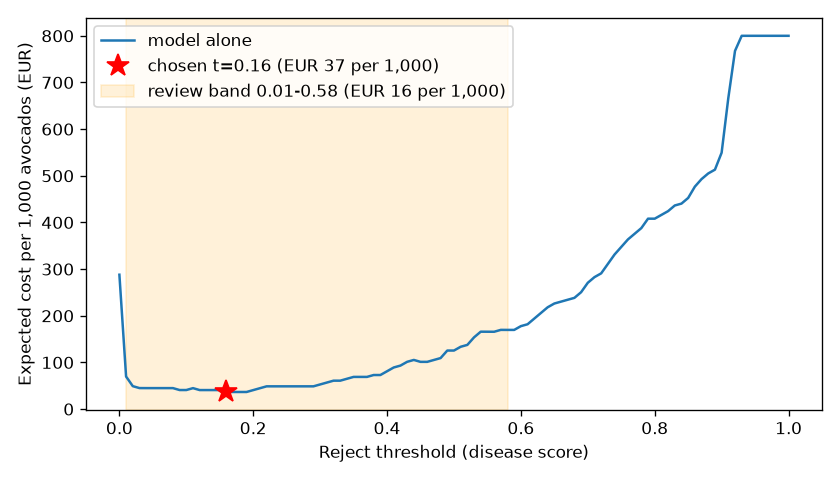

# Assignment 2 Report

- **Name**: Bernarda Andrade
- **Student ID**: 19119
- **Email**: bandrade.ieu2022@student.ie.edu
- **Group**: BBADBA 5A

## Business problem and My Identified Cost of Error 

I wanted to look for a business scenario that actually intrested me so I decided on my family's business, Alobuela it is a small avocado producer in Ecuador. Before
fruit is exported we have a worker that looks at each avocado and decides whether it is healthy enough to
export if it should be discarted. This model supports that decision at the sorting table it will hopefully flags avocados showing disease (anthracnose,
Cercospora spot, sunblotch or stem-end rot) so they can be pulled before packing.

The two mistakes do not cost the same because rejecting a healthy avocado (false positive) loses the difference between its export price and what it sells for
on the local market, about €0.11. Exporting a diseased one (false negative) can ruin a whole box, because rot spreads to the fruit around it and the buyer
discounts the box. From Ecuadorian export prices that comes to about €7.04 (explained below). A missed diseased avocado is therefore roughly 64 times more
costly than a wrongly rejected healthy one. This is why I care more about recall on the diseased class than about precision, and why the threshold ends up low.

## Dataset

**Roboflow Universe:** workspace `yaiinternsproject`, project `avocado-foo4c`,
version `1`:
https://universe.roboflow.com/yaiinternsproject/avocado-foo4c/dataset/1
(CC BY 4.0, object detection, YOLOv11 format, images resized to 640×640).

One image is usually a photo of a single avocado (median of one labelled object
per image), with a bounding box around each fruit labelled with its condition.
There are five classes: **Anthracnose**, **Cercospora Spot**, **Healthy**,
**Stem End Rot** and **Sunblotch**.

For the decision I group them: the **positive class is "diseased"** (any of the
four diseases = reject) and the **negative class is "Healthy"** (export). The
model still learns all five classes so I can report each one separately.

This dataset fits the problem because it labels the specific skin diseases a
sorter looks for before export, not just "good" and "bad" fruit, and it
includes a Healthy class (103 test boxes) to measure false alarms against. 

I did find its limitations in two ways. First, the photos are not from a sorting table in
the images I looked at there were studio shots on a white background,
supermarket shelf photos and even collage figures taken from research papers. This of course could limit the real life applicaiton given that the image quality of a actual sensor would not be the same. Then the second limitation is that the Stem End Rot disease has almost no examples (explained below).

## What the dataset's composition implies

Computed from the label files (`artifacts/dataset_stats.csv`):

| Split | Images | Anthracnose | Cercospora Spot | Healthy | Stem End Rot | Sunblotch |
|---|---|---|---|---|---|---|
| Train | 6,081 (≈2,027 originals × 3 augmented copies) | 3,060 | 2,397 | 2,574 | **21** (≈7 originals) | 1,080 |
| Valid | 541 | 299 | 216 | 220 | **0** | 58 |
| Test | 268 | 133 | 114 | 103 | **0** | **26** (in 12 images) |
| Median box size, % of image (test) | | 17% | 36% | 34% | n/a | 10% |

Of the 268 test images, 198 contain at least one diseased avocado and 70 are
healthy only. Most images show one avocado that fills a large part of the frame.

**Stem End Rot cannot be evaluated.** It has about 7 original training photos
and none in validation or test, so I have no measured performance for it at
all: I do not know whether the model catches it, only that I cannot say. With
so few examples it has probably learned very little, and as far as I understand
stem-end rot starts at the stem and can be hard to see from outside. Because a
missed diseased avocado is my expensive error (€7.04), this is a real blind spot. That is why i decided that 
everything in this report covers only the four classes in the test set, and
before using this on the farm I would collect and label photos of stem-end rot and if it is too hard to obtain discard it from the model completly.

**Sunblotch is too thin to trust.** 26 boxes in 12 images means one or two
mistakes move its precision and recall by several points. The per-class numbers
I can trust are Anthracnose, Cercospora Spot and Healthy, each with 100+ test
boxes.

**The 74% diseased test split does not break the cost analysis.** On my families  farm I
assume 4% of avocados are diseased. The rates I use, the miss rate (share of
diseased avocados the model passes) and the false-alarm rate (share of healthy
avocados it rejects), are measured within each class, so they do not depend on
the mix. I measure them on the test split and then reweight to 4%:
expected cost per avocado = 4% × miss rate × €7.04 + 96% × false-alarm rate × €0.11.
What the mix does change is anything that blends the classes. At my chosen
single threshold, precision on the test split is 97% (194 of 201 rejections are
really diseased), but at a 4% base rate only about **29% of rejections would be
truly diseased**, so most rejected fruit at the farm would be healthy. The test mix
also limits how precisely I can measure the rates: with only 70 healthy images,
each wrongly rejected healthy avocado moves the false-alarm rate by 1.4 points.

**The 0.80 mAP will probably not hold on the farm; I treat it as an upper
bound.** The test images look like the training images (same sources, same
studio and supermarket style), not like avocados on my family's sorting table,
with different lighting and infinite possibly varieties. I also found
at least one test image that is the same photo as a training image, slightly
cropped, which inflates the score. Real miss rates are likely higher, so real
costs are higher too. I am aware that before relying on any of these numbers I would run a
small pilot so that I can photograph a few hundred avocados on the actual sorting table,
label them, and measure again.

## Finetuning and baselines

**Model and task.** I finetuned `yolo11n` for **object detection** rather than
image classification, for three reasons:

- Because most of the pictures in the data set have more than one avocado in the image some even
  up to ten. I realized that a  classifier would give one label per image, so a tray with one diseased
  fruit among healthy ones would get a single label that doesn't say which fruit
  is the problem. So I need detector boxes and label each one.
- The box would help the worker where to look. A fruit sent for review can be
  confirmed or overruled in a few seconds because the reviewer goes straight to
  the boxed spot. I assumed it would take around 6 second to analyze.
- Boxes make mistakes visible. If the model flags a fruit because of a shadow
  or a sticker, the box shows it; a bare "diseased" label would hide it.

The trade off is that detection needs box annotations, which are more work to
produce than image labels. Luckly here the dataset already has them.

**Training.**  I started from the
pretrained COCO `yolo11n.pt` checkpoint: 40 epochs, image size 640, batch 16,
early-stopping patience 10, seed 0. It took 2.3 hours. The best epoch (by
Ultralytics' validation fitness score, mainly mAP50-95) is saved as `weights/avocado_yolo11n.pt`.

**Results on the same 268-image test split.** For the decision, each image gets
one score: the highest confidence of any disease box. The cost column uses my
Ecuador figures, with each model's single threshold chosen on the validation
split and its cost measured on the test split.

| Model | mAP50 | mAP50-95 | Diseased-vs-healthy AUC | Cost per 1,000 avocados (test) |
|---|---|---|---|---|
| **Finetuned yolo11n** | **0.800** | **0.526** | **0.987** | **€16.25** |
| COCO yolo11n, zero-shot | 0 | 0 | 0.46 | €105.60 (best it can do is reject everything) |
| Trivial: predict nothing (export everything) | 0 | 0 | 0.50 | €281.60 |
| Trivial: majority class of the test split (reject everything) | 0 | 0 | 0.50 | €105.60 |

The COCO model has no avocado or disease classes, so it cannot name a lesion
however good its general vision is; its mAP on my classes is zero by
definition. For its decision score I used the highest confidence of anything it
detects. That gives an AUC of 0.46, which is essentially chance (0.5 means no
signal), so it is no better than the trivial baselines. It is a floor: what I
would get without finetuning. Finetuning works this well because the network
already knows general visual features (edges, textures, shapes) from
pretraining and only has to learn the avocado specific classes. The gap between
finetuned and COCO is real but as I mentioned the absolute 0.80 is measured on
images like the training data and may not carry over to the farm.

The gap is about what I expected, I thought finetuning on a few thousand
labelled photos would clearly beat a model that has never seen these classes.
What surprised me more was how completely the COCO model fails. I expected a
strong general model to pick up at least some signal, but with an AUC of 0.46
it does no better than chance, which shows that general object recognition
does not transfer to telling a diseased avocado from a healthy one.

## Per-class evaluation and failure modes

**Positive class:** diseased (any of the four diseases). Per class, on the test
split:

| Class | Test boxes | Precision | Recall | AP50 | AP50-95 |
|---|---|---|---|---|---|
| Cercospora Spot | 114 | 0.84 | 0.82 | **0.86** | 0.68 |
| Healthy | 103 | 0.73 | 0.80 | 0.85 | 0.64 |
| Sunblotch | 26 | 0.82 | 0.89 | 0.83 | 0.41 |
| **Anthracnose** | 133 | **0.67** | **0.61** | **0.66** | **0.37** |
| Stem End Rot | 0 | n/a | n/a | n/a | n/a |
| **All (mAP)** | 376 | | | **0.80** | **0.53** |

Confusion matrix at confidence 0.25 (each row is the true class, each column
what the model predicted; "missed" means no box at all):

| True ↓ / Predicted → | Anthracnose | Cercospora | Healthy | Sunblotch | Missed |
|---|---|---|---|---|---|
| Anthracnose (133) | **84** | 6 | **7** | 1 | **35** |
| Cercospora Spot (114) | 4 | **93** | 0 | 3 | 14 |
| Healthy (103) | 3 | 1 | **84** | 0 | 15 |
| Sunblotch (26) | 0 | 0 | 0 | **23** | 3 |
| No object (false boxes) | 37 | 10 | 28 | 1 | |

**Cercospora Spot carries the headline number**: large, clearly visible spots,
the best AP50 and very few confusions. **Anthracnose drags it down.** It is
the most common disease in the test set, yet the model misses about a quarter
of its lesions entirely (35 of 133) and calls 7 of them Healthy, which is
the dangerous confusion for my decision. It also produces the most false boxes
(37), so the model is both missing real Anthracnose and seeing it where there
is none.

**Why Anthracnose is hardest: the lesions it misses are small.** I checked the
missed cases rather than assume it. The Anthracnose lesions the model found
cover a median of 25% of the image; the ones it missed cover 6.5%. Almost half
of the missed lesions (46%) are smaller than 5% of the image, against 7% of the
found ones. After the image is shrunk to 640 pixels, a lesion that small is only
a handful of pixels, and an early dark spot can look like an ordinary bruise or
blemish. Small boxes are also scored harshly, because a few pixels of offset is
enough to fail the overlap rule.

**At the level of my decision** (one score per image), the misses look
different. At my single threshold of 0.05, 4 of 198 diseased images are
exported. Every one of them involves Anthracnose, and none is a clean
single-fruit photo: one is a research-paper figure, two are stock photos of
piles with many avocados, and one is a phone photo of a fruit held in a hand.
So the model fails on small lesions and on images unlike its typical training
photo.

**What this means for the farm.** The model's weakest class is exactly where an
error costs most so a missed diseased avocado costs €7.04, about 64 times the
€0.11 of rejecting a healthy one. Even with the review band, over a third of
the remaining cost (€2.84 of the €7.80 per 1,000) comes from the 1% of diseased
avocados that still get exported, all Anthracnose. To reduce it I would
photograph closer or at higher resolution so small spots cover more pixels,
collect more labelled Anthracnose examples.

## Cost matrix and operating point

The prices come from official Ecuadorian statistics and the box assumptions are
mine. Everything is stored in `costs.json`, including the derivation. Dollars
are converted at the ECB's 2025 average of $1.13 per euro.

**Inputs:**

- **Export price, $1.99/kg.** In 2025 Ecuador exported 1,778.81 tonnes of
  avocado for $3.54 million FOB (Banco Central del Ecuador, reported by
  Expreso, 2026), which is $1.99/kg.
- **Local price, $1.50/kg.** The Ministry of Agriculture's producer-price
  bulletin (MAG/SIPA, November 2025) gives $30.00 for a gaveta of about 44 lb
  (about 20 kg) of aguacate fuerte at the farm gate, which is $1.50/kg.
- **Box assumptions (mine).** An export box holds 16 avocados of about 0.25 kg
  each (4 kg). A rotten avocado spoils about 2.5 of its neighbours, and a buyer
  who finds rot discounts the box in full.

**Derived costs per avocado:**

- **One export avocado** = 0.25 kg × $1.99 = $0.50 = **€0.44**.
- **FN, €7.04.** The diseased avocado and the 2.5 neighbours it spoils are lost
  (3.5 × €0.44 = €1.54), and the buyer discounts the other 12.5 avocados in the
  box (12.5 × €0.44 = €5.50). So one missed diseased avocado costs the whole
  box: 16 × €0.44 = **€7.04**.
- **FP, €0.11.** A rejected healthy avocado still sells locally, so the loss is
  the price gap: 0.25 kg × ($1.99 − $1.50) = $0.12 = **€0.11**. This slightly
  overstates the gap, because the FOB price also covers packing and transport
  to port.
- **TP and TN, €0.** These are the correct outcomes and I count them as
  costing nothing relative to each other.
- **Human check, €0.006.** 6 seconds per avocado at **€3.45/h**. Ecuador's
  minimum wage is $482 a month in 2026 ($470 in 2025). With the 11.15% employer
  IESS contribution, the 13th and 14th salaries, vacation and fondos de reserva,
  that is about $676 a month for the employer, or $3.90 an hour over 173 hours.
- **Human accuracy, 97%** (my assumption). A person at the sorting table tires
  over a shift and will not catch every case.
- **Base rate, 4%** (my assumption). Real harvests are mostly clean, unlike the
  test split (74% diseased), so all costs are reweighted to 4%.

| Actual ↓ / Decision → | Export | Human review | Reject |
|---|---|---|---|
| **Diseased** | **€7.04** (FN) | €0.006 check + 3% × €7.04 = €0.22 | €0 (TP) |
| **Healthy** | €0 (TN) | €0.006 check + 3% × €0.11 = €0.009 | **€0.11** (FP) |

**The sweep.** I swept the reject threshold from 0 to 1 in steps of 0.01. To
avoid tuning and scoring on the same images, I **choose the threshold on the
validation split (541 images) and report its cost on the test split (268
images)**:

The validation minimum is at **0.05**. On the test split it catches 98% of
diseased avocados (4 of 198 exported) and wrongly rejects 10% of healthy ones
(7 of 70), costing **€16.25 per 1,000**. The threshold is low for two reasons. A
missed diseased avocado costs about 64 times more than a wrongly rejected
healthy one, so it pays to reject on weak evidence. And the model separates the
two classes sharply, so a low bar costs few false alarms. Above about 0.6 the
cost climbs steeply, because diseased avocados start being exported.

Choosing on validation matters. If I had tuned on the test split itself, I
would have picked 0.16 and reported €13.15 per 1,000, about 20% better than
what the threshold actually achieves on unseen images.

**The assumption that would most change my answer is the FN cost**, because it
rests on my box assumptions (2.5 spoiled neighbours, a full discount on the
box). I re-ran the analysis at other values. The design I chose (review band
0.01 to 0.57, 20% to review) stays the cheapest for any FN cost between about
**€3.50 and €16**. Below €3.50 the band narrows and only 10% goes to review.
Above €16 the upper threshold drops to 0.42, so more fruit is rejected outright
and 15% goes to review; from about €19 it becomes cheaper to send almost
everything (91%) to a person. For the base rate, the same design holds from
**2% to 8%**. Because €7.04 sits in the middle of the €3.50–16 range, my
decision does not depend on the exact figure. It would change if, say, the
buyer discounted only a quarter of the box (FN about €2.90).

## What a person still has to check

**Two thresholds, three outcomes:**

- disease score **≥ 0.57 → reject**
- **0.01 to 0.57 → send to a person**
- **< 0.01 → export**

These are the pair that costs least on the validation split when I search
every combination, with reviewed fruit costing €0.006 plus the person's 3%
error rate. On the test split, this band rejects 157 diseased and 1 healthy
avocado, sends 39 diseased and 14 healthy to a person, and exports 55 healthy
and 2 diseased.

**Load.** Reweighted to a 4% base rate, **20%** of avocados go to review. At
5,000 avocados a day that is about **1,000 checks**; at 6 seconds each that is
**1.7 hours a day**, about **a quarter of one person's 7-hour working day**.
That is realistic for my family's farm. A worker who is already at the sorting
table can check the flagged fruit part-time, so no new hire is needed. At peak
harvest, volume may rise, but even doubling it needs only half a person.

**Priced against the alternatives** (€ per 1,000 avocados on the test split, at
a 4% base rate):

| Policy | € per 1,000 | Comment |
|---|---|---|
| Do nothing (export everything) | €281.60 | All 40 diseased avocados shipped at €7.04 each |
| Reject everything | €105.60 | All 960 healthy avocados sold locally at a €0.11 loss |
| Person checks everything | €17.37 | 8.3 hours a day, about 1.2 people; 3% of disease still missed |
| Model decides alone (threshold 0.05) | €16.25 | No labour, but 2% of diseased exported and 10% of healthy rejected |
| **Model + human review (0.01 / 0.57)** | **€7.80** | A quarter of a person a day |

With Ecuadorian wages, a person checking everything is barely more expensive
than the model alone, so the model's value here is not replacing labour. It is
combining the two: the model handles the clear cases at both ends (80% of
avocados) and a person handles only the uncertain middle. That more than halves
the cost of either on its own. Over a third of the remaining €7.80 comes from
the 2 diseased avocados in 198 that still score below 0.01 and get exported,
both Anthracnose cases.

**Would I ship it?** Yes, but only after a pilot. The design is clearly
cheaper than the alternatives on these numbers, but the numbers come from photos
unlike my family's sorting table. Before
relying on it I would photograph and label a few hundred avocados on the actual
sorting table, re-measure the miss and false-alarm rates, and re-run the same
cost sweep with them.

## Limitations & next steps

1. **The photos are not from a sorting table.** The dataset mixes studio shots,
   supermarket photos, research paper figures ect. Every number
   here (0.80 mAP, 97.5% recall, €16 per 1,000) is measured on images like
   that, so it is an upper bound for the farm. I would add photograph and label a
   few hundred avocados on my family's sorting table, under its real lighting,
   and use them as the test set. Then re run the same cost sweep.
2. **Stem End Rot is untested.** About 7 training photos and none in
   validation or test, so I have no evidence the model catches it. *Fix:*
   collect labelled stem-end-rot photos. Until then, any fruit a sorter suspects
   of it goes to a person regardless of the model.
3. **Anthracnose misses small lesions.** Missed lesions have a median size of
   6.5% of the image, against 25% for found ones, and every diseased avocado
   the model exports involves Anthracnose. *Fix:* photograph closer or at
   higher resolution (or train at a larger image size than 640), and add more
   labelled early-stage Anthracnose, especially spots that look like bruises.
4. **At least one test image duplicates a training image.** I found a test
   photo that is the same as a training photo, only slightly cropped, and two
   automatic checks I tried (image hashing and embeddings) could not reliably
   find others. Test scores may therefore be a little optimistic. *Fix:* split
   the original images myself by source, so near-copies cannot land on both
   sides, and retrain.
5. **The test split is small for the rates that matter.** With 70 healthy
   images, one wrongly rejected avocado moves the false-alarm rate by 1.4
   points, and the lower threshold of 0.01 separates only a couple of diseased
   images from the healthy ones. The validation split was also used to pick the
   best training epoch, so it is not completely independent of the model.
   *Fix:* a larger test set, and confidence intervals on the miss and
   false-alarm rates (for example by bootstrapping the test images) before
   choosing thresholds.
6. **The prices are national averages and the box effects are my
   assumptions.** The export and local prices are 2025 national figures, not my
   family's, and the 2.5 spoiled neighbours, the full box discount and the 4%
   base rate are my estimates. *Fix:* ask my family to log, for one season,
   rejected boxes, buyer claims and the prices they actually received, then
   replace these figures. The sensitivity check shows the design holds for an
   FN cost between about €3.50 and €16 and a base rate between 2% and 8%, so
   this mainly matters if the real figures fall outside those ranges.
7. **The model scores the whole photo, not each avocado.** My decision uses the
   highest disease score in an image, so in a photo of several avocados one
   diseased fruit flags the whole image. On a sorting table each avocado would
   be photographed on its own, so the decision would be per fruit, as intended.
   In the pilot, take one photo per avocado.

## Generative AI use disclosure

I used Claude  throughout this assignment. I 
searched Roboflow Universe and looked for the avocado dataset, downloaded the
data and computed the class counts, claude helped me write the code: the training and
evaluation pipeline (`train.py`), the cost model (`decision.py`) and the Gradio
dashboard (`app.py`). It also ran the analyses I asked for (the missed
Anthracnose cases, the sensitivity of the design to the FN cost), found the
official statistics I asked for (Banco Central del Ecuador export figures, the
MAG producer-price bulletin, the minimum wage and the ECB exchange rate),
computed the cost derivation from them.

The decisions are mine: framing the problem around my family's avocado farm in
Ecuador, choosing the rot and disease dataset, treating any disease as the
positive class, the box assumptions behind the FN cost (16 avocados per box,
2.5 spoiled neighbours, a full discount), the 4% base rate, which assumption I
consider most uncertain, whether the review load is realistic, and that I
would only ship this after a pilot. I checked the results against the
dashboard and can explain each number in this report.

## Sources

**Business context**

- Alobuela, my family's avocado business in Ecuador: the sorting and export
  decision this report models comes from how the business works. No records
  from the business were used; all figures below are public statistics or my
  stated assumptions.

**Data and model**

- YAIInternsProject (2025). *avocado* dataset, version 1, Roboflow Universe,
  CC BY 4.0. https://universe.roboflow.com/yaiinternsproject/avocado-foo4c/dataset/1
- Ultralytics YOLO11 (`yolo11n.pt`, COCO-pretrained), Ultralytics 8.4.
  https://docs.ultralytics.com/models/yolo11/

**Prices, wages and exchange rate (cost matrix)**

- Banco Central del Ecuador, avocado exports 2025 (1,778.81 t, $3.54 million),
  reported in Expreso (2026), "Las condiciones climáticas atípicas desafían el
  inicio de la cosecha de aguacate Hass en Ecuador".
  https://www.expreso.ec/economia-y-negocios/condiciones-climaticas-atipicas-desafian-inicio-cosecha-aguacate-hass-ecuador-298797.html
- Ministerio de Agricultura y Ganadería, SIPA (2025). *Boletín de Precios
  Promedios Ponderados al Productor*, noviembre 2025 (aguacate fuerte, gaveta
  aprox. 44 lb, $30.00).
  https://sipa.agricultura.gob.ec/boletines/nacionales/productor/2025/boletin_precios_productor_noviembre_2025.pdf
- Primicias (2024). "Salario Básico Unificado de Ecuador subirá a USD 470 en
  2025".
  https://primicias.ec/economia/salario-basico-unificado-ecuador-2025-gobierno-daniel-noboa-85414
- El Universo. Salario básico unificado de $482 y aportes al IESS.
  https://www.eluniverso.com/noticias/economia/salario-basico-unificado-482-aportes-iess-ecuador-2025-nota/
- Hacecuentas. Calculadora de costo laboral total del empleador, Ecuador
  (employer cost of about $676 per month at the $482 minimum wage).
  https://hacecuentas.com/ec/calculadora-costo-laboral-total-empleador-ecuador
- Bank of Finland (2026). Average annual exchange rates for the year 2025 (ECB
  euro reference rates, $1.13 per euro).
  https://www.suomenpankki.fi/en/statistics/interest-rates-and-exchange-rates/exchange-rates/average-annual-exchange-rates-for-the-year-2025/
